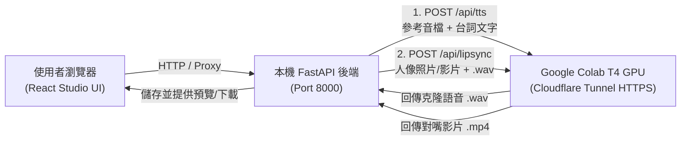

# AI Avatar Studio — 一站式聲音克隆 × 人物對嘴影片平台

AI Avatar Studio 是一個仿照 HeyGen 工作流程設計的開源全端平台，整合**文字轉克隆語音（Zero-Shot Voice Cloning TTS）**與**人物對嘴影片生成（Lip-Sync）**。  
考量本機環境不一定具備 NVIDIA GPU，本專案採用「**本機輕量前後端 + Google Colab 免費 T4 GPU 遠端推論**」的混合架構，同時內建免 GPU 的 **Demo 模擬模式**，並支援透過 GitHub Pages 部署純靜態前端。

---

## 一、 使用的資源與技術棧（Tech Stack & Resources）

### 1. 前端介面（`frontend/`）
| 技術 / 套件 | 用途說明 |
| :--- | :--- |
| **React 19 + Vite 6** | 建置高速、響應式的單頁式 Studio 操作介面 |
| **Tailwind CSS v4** | 深色模式三欄式 Studio UI 排版與元件樣式 |
| **Lucide React** | 介面圖示庫（分身、麥克風、狀態燈號、下載等） |

### 2. 本機後端與任務管線（`backend/`）
| 技術 / 套件 | 用途說明 |
| :--- | :--- |
| **FastAPI + Uvicorn** | 提供 REST API、靜態媒體檔案服務（`/media`）與非同步背景任務執行 |
| **Pydantic v2** | 請求參數驗證與資料模型定義（`AvatarAsset`、`VoiceAsset`、`JobRecord`） |
| **HTTPX** | 非同步 HTTP 用戶端，負責將音檔與人像傳送至遠端 Colab GPU Worker |
| **JSON File Store (`data/db.json`)** | 輕量級本機資料持久化，無須額外安裝資料庫 |

### 3. 遠端 AI 推論引擎（`colab/AI_Avatar_Colab_Worker.ipynb`）
| 模型 / 工具 | 用途說明 |
| :--- | :--- |
| **F5-TTS (`F5TTS_v1_Base`)** | 零樣本（Zero-Shot）文字轉語音與聲音克隆模型，支援中、英、日與混讀，只需 5～15 秒參考音檔即可複製聲線 |
| **Wav2Lip-GAN (`wav2lip_gan.pth`)** | 人物嘴型同步（Lip-Sync）模型，搭配 S3FD 人臉偵測（`s3fd.pth`），可驅動單張人像照片或既有影片 |
| **FFmpeg** | 音訊取樣率轉換（24kHz / 16kHz 單聲道 WAV）與本機 Demo 示範影片合成 |
| **Cloudflare Tunnel (`cloudflared`)** | 免註冊即可在 Colab 產生臨時 HTTPS 公開通道，讓本機或網頁端安全連線至 Colab GPU |

---

## 二、 系統架構與實作方式（How It Works）



### 運作流程說明
1. **素材管理（Asset Library）**：使用者於左側面板上傳「人物分身（JPG/PNG 照片或 MP4 影片）」與「參考聲音樣本（5～30 秒 WAV/MP3）」，後端將檔案儲存於 `data/uploads/` 並寫入 `data/db.json`。
2. **雙模式工作區（Studio Workspace）**：
   * **模式 A（文字腳本 + 聲音克隆 $\rightarrow$ 對嘴影片）**：輸入台詞與語速，後端先呼叫 Colab `/api/tts` 由 F5-TTS 生成克隆語音 `.wav`，再將 `.wav` 與分身送往 `/api/lipsync` 由 Wav2Lip 合成對嘴 `.mp4`。
   * **模式 B（直接上傳語音 $\rightarrow$ 對嘴影片）**：跳過 TTS，直接把上傳的語音檔與分身送往 `/api/lipsync` 對嘴。
3. **Demo 模擬模式**：當尚未連接 Colab GPU 時，後端會自動生成示範音訊（並於本機有安裝 `ffmpeg` 時合成示範 MP4），確保無 GPU 環境也能完整操作介面與任務佇列。
4. **GitHub Pages 靜態模式**：若直接透過 GitHub Pages 開啟前端（無本機 FastAPI 後端），前端會自動切換為瀏覽器本機記憶模式，並可直接透過 CORS 呼叫您設定的 Colab Worker URL。

---

## 三、 本機啟動與 Colab 串接教學

### 1. 本機安裝與啟動

**啟動後端（Port 8000）**
```powershell
cd backend
python -m venv .venv
.\.venv\Scripts\pip.exe install -r requirements.txt
.\.venv\Scripts\uvicorn.exe main:app --host 127.0.0.1 --port 8000
```

**啟動前端（Port 5173）**
```powershell
cd frontend
npm install
npm run dev -- --host 127.0.0.1 --port 5173
```
開啟瀏覽器前往 `http://127.0.0.1:5173`。

### 2. 串接 Google Colab T4 GPU
1. 將 `colab/AI_Avatar_Colab_Worker.ipynb` 上傳至 [Google Colab](https://colab.research.google.com/)。
2. 上方選單點選 **執行階段 $\rightarrow$ 變更執行階段類型 $\rightarrow$ 選擇 `T4 GPU`**。
3. 依序執行 3 個儲存格，第 3 格執行後會印出一組 `https://xxxx.trycloudflare.com` 網址。
4. 回到網頁右上角點擊設定按鈕，取消勾選「啟用 Demo 模擬模式」，貼上該網址並點擊「測試 Colab 連線」後儲存。

---

## 四、 測試方法（How to Test）

### 1. 後端 API 單元／冒煙測試（Smoke Test）
在啟動虛擬環境後，可使用 FastAPI `TestClient` 驗證核心路由與設定讀寫：
```powershell
cd backend
.\.venv\Scripts\python.exe -c "from fastapi.testclient import TestClient; import main; c = TestClient(main.app); assert c.get('/api/health').json() == {'status': 'ok'}; print('Backend API OK:', c.get('/api/settings').json())"
```

### 2. 前端建置測試（Build Verification）
確認所有 React 元件與 Tailwind CSS 樣式可正常打包：
```powershell
cd frontend
npm run build
```

### 3. Colab GPU Worker 連線測試
可透過 PowerShell 或網頁介面「測試 Colab 連線」驗證遠端 T4 GPU 是否上線：
```powershell
Invoke-RestMethod -Uri "https://你的網址.trycloudflare.com/health"
# 預期回傳：{"status": "ok", "gpu": "Tesla T4", "engines": ["F5-TTS", "Wav2Lip-GAN"]}
```

### 4. 端到端功能測試（End-to-End）
1. **Demo 模式測試**：保持右上角為「Demo 模擬模式」，上傳一張人像與一段音檔，輸入台詞後點擊「開始生成對嘴影片」，確認右側任務進度條由 `5% -> 20% -> 65% -> 100%` 完成。
2. **真實 GPU 推論測試**：連接 Colab 後關閉 Demo 模式，點擊生成並觀察右側進度與最終下載的 `.mp4` 嘴型是否與語音同步。

---

## 授權條款
本專案採用 [MIT License](LICENSE) 授權。請注意：使用聲音克隆與人臉合成技術時，務必取得當事人授權並遵守相關肖像權與法規，切勿用於冒名詐騙或誤導性內容。
